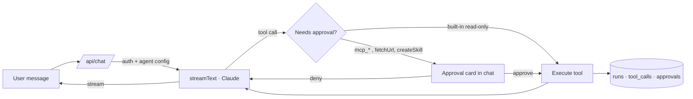

# orb

[](https://github.com/GaboRM9/orb/actions/workflows/ci.yml)

A calm, minimal agent workspace (AI SDK v7): chat, tools, skills, settings. libSQL storage (a local SQLite file, or Turso on Vercel), Anthropic models.

```
npm i && npm run dev -- -p 3100
```
Set `AUTH_SECRET` in `.env.local` (`openssl rand -base64 32`, see `.env.example`), then create the first user. It prints a generated password once:

```
npx tsx scripts/user.mts add you@example.com --admin
```

Add more people the same way (leave off `--admin` for a member; `--workspace <id>` for another workspace). Add your Anthropic key in Settings (or `ANTHROPIC_API_KEY` in `.env.local`).

**Roles:** admins manage the workspace: API keys, model, Generative UI, MCP connections (add, attach to agents, Always allow), and see every member's runs and approvals in Settings → Activity. Members chat, edit agents (but not their connections), skills and Knowledge, and change their own password. Agents, skills and Knowledge are shared; **chats belong to whoever started them** and only they can see, continue, stop or delete them. Their runs and approvals are theirs too: members see their own Activity, and only the chat's owner decides its approvals. `DAILY_BUDGET_USD` caps the whole workspace. Chats, runs and approvals from before users existed go to the workspace's first member.

## Deploy on Vercel

1. `vercel link`, then add the **Turso** integration (Marketplace → Storage). It sets `TURSO_DATABASE_URL` and `TURSO_AUTH_TOKEN`.
2. Set `AUTH_SECRET` (`openssl rand -base64 32`). It signs sessions and encrypts saved keys; changing it later signs everyone out and makes saved keys unreadable.
3. `vercel deploy --prod`. The schema is created on first request.
4. Create the first admin against the production database: `vercel env pull .env.local`, then `npx tsx scripts/user.mts add you@example.com --admin` (it uses `TURSO_*` when set).

Notes: request bodies are capped at 4.5 MB on Vercel, so Knowledge uploads are limited to 4 MB per request. Locally nothing changes: with no `TURSO_*` variables the app uses `data/app.db`. Use a separate Turso database for Preview deployments so previews can't write to production.

## How it works



Each request is one **run**: model, tokens (including cache reads/writes), cost, duration, every tool call and every approve/deny decision are written to the database and shown under Settings → Activity. The loop stops after 25 steps.

- **Stop** really stops: the button flags the thread in the database (`DELETE /api/chat?id=…`) and the running turn, on whichever instance, aborts within half a second and keeps what it has. Closing the tab does *not* stop a run: it finishes and is saved.
- **Daily budget:** set `DAILY_BUDGET_USD` and new turns are refused (429) once the day's runs cost that much. Costs use list prices in `lib/models.ts`.
- **Long threads** are trimmed to ~100k tokens before sending (old tool output first, then the oldest turns); the system prompt, tools and history are prompt-cached.

## Knowledge (RAG, Library → Knowledge)

Upload files or a folder, or import a GitHub repo's docs; they appear as a folder tree. Turn on the `searchKnowledge` tool in an agent and it retrieves the top passages and cites their path.

- **Hybrid search** (`lib/knowledge.ts`): SQLite FTS5 keywords fused with OpenAI `text-embedding-3-small` (512 dims) cosine similarity by reciprocal rank fusion. The cosine ranking runs inside the database (libSQL `vector_distance_cos`), so vectors never leave it.
- **Keyword-only without a key.** Set an OpenAI key in Settings → AI (or `OPENAI_API_KEY`) to add embeddings. Failed or missing embeddings never block an import; "Embed now" fills them in.
- **Minimal inference:** chunks are hashed, so re-imports only embed what changed, and each import embeds in one batched pass. Embeddings are only requested at import time and once per search.
- **Privacy:** with a key set, document text and search queries are sent to OpenAI.

## Safety and reliability

- **Approval gate:** every `mcp_*` tool, `fetchUrl` and `createSkill` waits for an explicit approve/deny in the chat (`toolApproval` in `app/api/chat/route.ts`). `createSkill` is off unless an agent has "Save new skills" turned on.
- **SSRF guard:** `fetchUrl` only talks to public http(s) hosts. All resolved addresses are checked (private, loopback, link-local, CGNAT, IPv4-mapped IPv6), redirects are re-validated per hop (max 3), the body is capped at ~64 KB and the request times out at 8 s (`lib/net-safe.ts`).
- **Untrusted tool output:** the system prompt tells the model that MCP output and knowledge passages are data and never instructions.
- **Fails closed:** with no `AUTH_SECRET` nobody can sign in. Passwords are scrypt-hashed; 5 misses lock an email for a minute. Sessions are HMAC-signed, 7-day tokens, compared in constant time; server actions re-check membership and role. Changing your password signs out every other device.
- **Dead MCP servers don't kill a run:** connections time out after 8 s, the server is skipped and the model is told it was unreachable.
- **Idempotent approval log:** approvals are stored once and decided once, so the same message can be synced on every turn.
- **Secrets at rest:** the saved API keys and MCP auth headers are encrypted (AES-256-GCM) with a key derived from `AUTH_SECRET`. (Locally, an older `ADMIN_PASSWORD` is still accepted in its place so existing installs keep working.)
- **Known limit:** DNS rebinding between the check and the connect isn't pinned (noted in the code).

## Generative UI tools (`lib/ui-tools.ts`, rendered in `components/gen-ui.tsx`)

| Tool | Kind | Renders |
|---|---|---|
| `askUser` | client (no `execute`) | form: text / number / select / toggle / slider / date / color |
| `choose` | client | option buttons (also confirm/deny) |
| `showPlan` | render | step checklist |
| `showCards` | render | card grid |
| `showTable` | render | table |
| `showChart` | render | bar chart |
| `showTimeline` | render | vertical timeline |
| `showMap` | render | map with places |

Client tools stop the model loop; the answer is sent with `addToolOutput` and
`sendAutomaticallyWhen: lastAssistantMessageIsCompleteWithToolCalls` resumes it.
