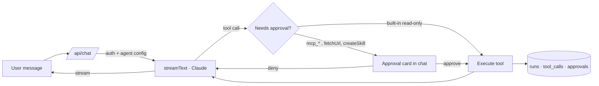

# orbz

[](https://github.com/GaboRM9/orbz/actions/workflows/ci.yml)

A calm, minimal agent workspace (AI SDK v7): chat, tools, skills, settings. SQLite storage, Anthropic models.

```
npm i && npm run dev -- -p 3100
```
Set `ADMIN_PASSWORD` in `.env.local` (see `.env.example`); without it nobody can sign in. Add your Anthropic key in Settings (or `ANTHROPIC_API_KEY` in `.env.local`).

## How it works



Each request is one **run**: model, tokens, duration, every tool call and every approve/deny decision are written to SQLite and shown in the Runs tab. The loop stops after 8 steps.

## Safety and reliability

- **Approval gate:** every `mcp_*` tool, `fetchUrl` and `createSkill` waits for an explicit approve/deny in the chat (`toolApproval` in `app/api/chat/route.ts`).
- **SSRF guard:** `fetchUrl` only talks to public http(s) hosts. All resolved addresses are checked (private, loopback, link-local, CGNAT, IPv4-mapped IPv6), redirects are re-validated per hop (max 3), the body is capped at ~64 KB and the request times out at 8 s (`lib/net-safe.ts`).
- **Untrusted tool output:** the system prompt tells the model that MCP output is data and never instructions.
- **Fails closed:** with no `ADMIN_PASSWORD` nobody can sign in. Sessions are HMAC-signed, 7-day tokens, compared in constant time; server actions re-check auth.
- **Dead MCP servers don't kill a run:** connections time out after 8 s, the server is skipped and the model is told it was unreachable.
- **Idempotent approval log:** approvals are stored once and decided once, so the same message can be synced on every turn.
- **Known limit:** DNS rebinding between the check and the connect isn't pinned (noted in the code).

## Generative UI tools (`lib/ui-tools.ts`, rendered in `components/gen-ui.tsx`)

| Tool | Kind | Renders |
|---|---|---|
| `askUser` | client (no `execute`) | form: text / number / select / toggle / slider / date / color |
| `choose` | client | option buttons (also confirm/deny) |
| `showPlan` | render | step checklist |
| `showCards` | render | card grid |
| `showTable` | render | table |
| `showChart` | render | bar chart |
| `showTimeline` | render | vertical timeline |
| `showMap` | render | map with places |

Client tools stop the model loop; the answer is sent with `addToolOutput` and
`sendAutomaticallyWhen: lastAssistantMessageIsCompleteWithToolCalls` resumes it.
